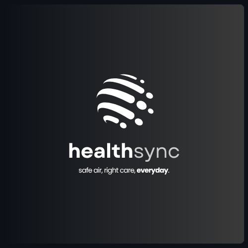

# congressional_app_challenge

This is the project repository for the 2026 Congressional App Challenge, involving the team members Aasrith Jangala (myself), Mithun Sethuraman, Koundinya Namuduri, and Advaith Atulasimha.

# launch (intended for Hack Club’s Open-Source Congressional App Challenge Certificate)

Fork this repository by navigating to the top right-hand side and selecting "Fork." Then, click the "Code <>" dropdown on the forked repository and copy the HTTPS URL. Next, create a folder via File Explorer or CLI, navigate into that folder, and type `git clone` followed by the URL of the forked repository, preferably via CLI. Subsequently, type `git pull origin main` to pull all the assets from the main repository into your editor. Optionally, you can set your upstream by typing `git remote add upstream **https://github.com/aasrithj/congressional_app_challenge/**`, which will sync all new edits from the main repository. Then, once you have pulled all the assets, enter `code .` to open the project in VSCode (reference the list of commands via CLI if your editor is **not** VSCode (e.g., `kiro .`)). Once you have the project open in VSCode, ensure you have the "Live Server" extension installed. If you don't already have it installed, navigate to the left-hand bar of VSCode and click "Extensions" and search "Live Server" in the search bar to install it. Once the installation is completed, open the `www` folder and right-click the `index.html` file. Search for the "Open with Live Server" option in the list and launch the site to use, explore, and test it.

# license

All rights reserved. This project and its code are the exclusive property of Aasrith Jangala, Mithun Sethuraman, Koundinya Namuduri, and Advaith Atulasimha. No permissions are granted for copying, modifying, or redistributing this work.
